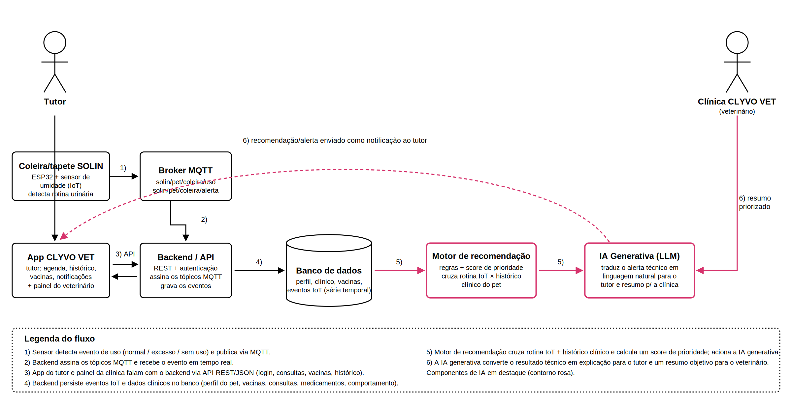
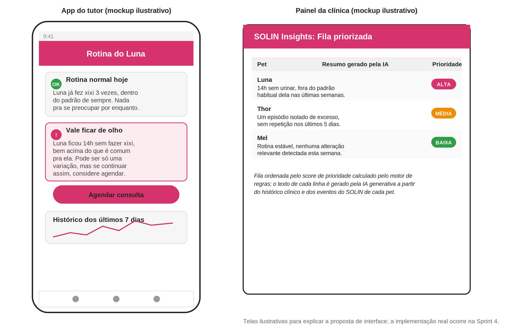

# CLYVO VET, Componente de Inteligência Artificial (SOLIN Insights)

Challenge 2026, 2º Semestre
Disciplina: Disruptive Architectures: IoT, IoB & Generative AI
Entrega: Sprint 3, definição e documentação da solução de IA

## Equipe

| Nome | RM |
|---|---|
| Natália Cristina | 564099 |
| Nickolas Davi | 564105 |
| Rodrigo Silva | 565162 |
| Samara Vilela | 566133 |
| Otávio Ferreira | 565960 |

## Sobre esta entrega

Nas sprints anteriores construímos o SOLIN, uma coleira e um tapete inteligente (ESP32 + sensor de umidade) que monitora a rotina urinária do pet e envia os eventos em tempo real via MQTT para um dashboard. O repositório do SOLIN está em: https://github.com/Rcsilva05/solin-iot

Esta entrega é a etapa de definição e documentação do componente de Inteligência Artificial que vai se integrar a essa base, dentro do app CLYVO VET. Aqui não há código de IA ainda, essa parte é implementada na Sprint 4. O que entregamos agora é: o problema que a IA resolve, os dados que ela usa, a abordagem escolhida e justificada tecnicamente, a arquitetura de integração e um vídeo pitch apresentando a proposta.

## Link do vídeo

Vídeo pitch (YouTube): **https://youtu.be/SywhlNYx1O0**

## O que tem neste repositório

| Arquivo | Conteúdo |
|---|---|
| [`CLYVO_VET_Documentacao_IA.docx`](CLYVO_VET_Documentacao_IA.docx) | Documentação completa: problema de negócio, papel da IA, abordagem escolhida e justificativa técnica, dados necessários, fluxo de dados, diagrama de arquitetura e mockup ilustrativo das telas |
| [`Figura_Arquitetura_SOLIN_IA.png`](Figura_Arquitetura_SOLIN_IA.png) | Diagrama de arquitetura mostrando a comunicação entre o SOLIN (IoT), o backend/app CLYVO VET, o banco de dados e os componentes de IA |
| [`Figura_Mockup_Telas_IA.png`](Figura_Mockup_Telas_IA.png) | Mockup ilustrativo de como a recomendação da IA apareceria no app do tutor e no painel da clínica |

## Diagrama de arquitetura

Fluxo entre o sensor SOLIN (IoT), o backend/app CLYVO VET, o banco de dados e os componentes de IA:

## Mockup ilustrativo das telas

Simulação de como a recomendação da IA apareceria no app do tutor e no painel da clínica (implementação real na Sprint 4):

## Resumo da proposta

O componente de IA, chamado internamente de SOLIN Insights, cruza os eventos captados pela coleira/tapete (uso normal, uso excessivo, ausência prolongada de uso) com o histórico clínico de cada pet (idade, raça, condições registradas, vacinas, medicações) para calcular um nível de prioridade e gerar duas comunicações diferentes: uma explicação simples para o tutor e um resumo técnico já priorizado para o veterinário.

A solução combina duas abordagens de IA:

- **Motor de recomendação com regras e score de prioridade**, escolhido em vez de um modelo de machine learning treinado porque ainda não existe histórico suficiente por pet nesta fase do projeto. É auditável pelo veterinário e evolui para um modelo preditivo quando a base de dados crescer.
- **IA Generativa (LLM)**, usada para traduzir o resultado técnico do motor de regras em linguagem natural, com tom diferente para o tutor e para a clínica.

Os detalhes completos, incluindo a tabela de dados utilizados e o diagrama de arquitetura com o fluxo numerado, estão na documentação técnica (`CLYVO_VET_Documentacao_IA.docx`).

## Tecnologias previstas para a implementação (Sprint 4)

- Motor de regras: lógica de negócio integrada ao backend da aplicação
- IA Generativa: modelo de linguagem (LLM) acessado via API
- Integração com os dados do SOLIN via MQTT e com o banco de dados já usado pelo app CLYVO VET
- Serviço de IA desacoplado do restante do backend, comunicando-se por uma API interna própria

## Resultados parciais

Até esta sprint, o componente de IA está definido e documentado, com a arquitetura de integração validada e o mockup das telas de recomendação já esboçado. A implementação (motor de regras, integração com o LLM e testes de ponta a ponta) está prevista para a Sprint 4, entrega de 04/11/2026.
